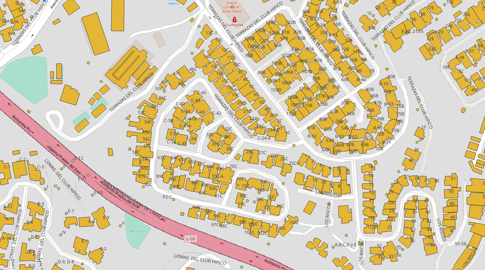

<aside>
<table align="right" style="padding: 1em">
<tr><td>Paquete <a target="_git" title="Enlace canónico a git para este paquete." href="http://git.digital-guard.org/preserv-VE/blob/main/data/M/Baruta/_pk0002.01"><big><b>pk0002.01</b></big></a> de <small><a target="_osmcodes" title="Jurisdicción" href="https://osm.codes/VE-M-Baruta">VE-M-Baruta</a></small>
</td></tr>
<tr><td>
Donante: <a rel="external" target="_doador" href="https://alcaldiabaruta.gob.ve/">Alcaldía del Municipio Baruta</a><br/>
<small>vatid:-1</small> • Wikidata <a rel="external" target="_doador" title="Enlace del descriptor Wikidata del donante" href="https://www.wikidata.org/wiki/Q761148">Q761148</a></small><br/>

Obtido via <i>email;site</i> em <b>1900-01-01</b> por:<br/>
 Avaliação técnica: <a rel="external" target="_gitPerson" title="Usuario de Git" href="https://github.com/crebollobr">crebollobr</a><br/>
 Representação institucional: <a rel="external" target="_gitPerson" title="Usuario de" href="https://github.com/ThierryAJean">ThierryAJean</a><br/>
</td></tr>
<tr><td>Camadas: <a title="via" href="#-via"></a> <a title="nsvia" href="#-nsvia"></a> <a title="building" href="#-building"></a> <a title="geoaddress" href="#-geoaddress"></a> </td></tr>
<tr><td><a href="http://git.digital-guard.org/preservCutGeo-VE2021/tree/main/data/M/Baruta/_pk0002.01">Datos publicados</a></td></tr>
</table>
</aside>

<section>

Este repositorio de metadatos describe un paquete de archivos donados al dominio público. Está siendo conservado por Digital Guard: para obtener más detalles, consulte la [documentación sobre el proceso de registro y conservación](https://git.digital-guard.org/preserv/tree/main/docs).

Nota. Este documento README fue generado por software a partir de la información contenida en el archivo [`make_conf.yaml`](make_conf.yaml) en este paquete, e información adicional de los catálogos de [donantes](https://git.digital-guard.org/preserv-BR/blob/main/data/donor.csv) y [paquetes](https://git.digital-guard.org/preserv-BR/blob/main/data/donatedPack.csv).

# Capas de datos

Los archivos contienen "capas de datos" temáticas. Los metadatos también describen cómo se evaluó cada capa y cómo se filtraron sus datos de forma estandarizada.

##  building

Nombre del archivo: `EDIFICACIONES_RV`.<br/>*Descarga* e integridad: [06c5461d0c7bdebd504d4033bab337b2d7a4aa236562e0704b9e49bc926a1fba.rar](http://dl.digital-guard.org/06c5461d0c7bdebd504d4033bab337b2d7a4aa236562e0704b9e49bc926a1fba.rar)<br/>Descripción: Baruta_Base.rar<br/>Formato: shp<br/>SRID: 32619

#### Datos publicados
[http://git.digital-guard.org/preservCutGeo-VE2021/tree/main/data/M/Baruta/_pk0002.01/building](http://git.digital-guard.org/preservCutGeo-VE2021/tree/main/data/M/Baruta/_pk0002.01/building)<br/>11047134 bytes (10.54 <abbr title="mebibyte">MiB</abbr>)<br/>36876 polígonos con 8.04 <abbr title="quilômetros quadrados">km²</abbr><br/>densidad media: 0.18 polígonos/km²
##  geoaddress

Nombre del archivo: `INMUEBLE_CATASTRADO_PTO`.<br/>*Descarga* e integridad: [06c5461d0c7bdebd504d4033bab337b2d7a4aa236562e0704b9e49bc926a1fba.rar](http://dl.digital-guard.org/06c5461d0c7bdebd504d4033bab337b2d7a4aa236562e0704b9e49bc926a1fba.rar)<br/>Descripción: Baruta_Base.rar<br/>Formato: shp<br/>SRID: 32619

#### Datos relevantes
* `n_civico` (house_number)

* `nom_urb` (nsvia)

* `via_acceso` (via)

#### Otros datos relevantes
* `sector`
* `manzana`
* `parcela`
* `sub_parcel`
* `nom_inmueb`
* `nom_edif_m`
* `tipo_inm`
* `uso`
* `orig_fid`

#### Datos publicados
[http://git.digital-guard.org/preservCutGeo-VE2021/tree/main/data/M/Baruta/_pk0002.01/geoaddress](http://git.digital-guard.org/preservCutGeo-VE2021/tree/main/data/M/Baruta/_pk0002.01/geoaddress)<br/>1060929 bytes (1.01 <abbr title="mebibyte">MiB</abbr>)<br/>20099 pontos<br/>densidad media de 199.78 pontos/km²
##  nsvia

Nombre del archivo: `URBANIZACIONES_RV`.<br/>*Descarga* e integridad: [06c5461d0c7bdebd504d4033bab337b2d7a4aa236562e0704b9e49bc926a1fba.rar](http://dl.digital-guard.org/06c5461d0c7bdebd504d4033bab337b2d7a4aa236562e0704b9e49bc926a1fba.rar)<br/>Descripción: Baruta_Base.rar<br/>Formato: shp<br/>SRID: 32619

#### Datos relevantes
* `nom_urb` (nsvia)

#### Otros datos relevantes
* `cod_urb`
* `tipo_desar`
* `pob_1998`
* `por_sector`

#### Datos publicados
[http://git.digital-guard.org/preservCutGeo-VE2021/tree/main/data/M/Baruta/_pk0002.01/nsvia](http://git.digital-guard.org/preservCutGeo-VE2021/tree/main/data/M/Baruta/_pk0002.01/nsvia)<br/>612480 bytes (0.58 <abbr title="mebibyte">MiB</abbr>)<br/>150 polígonos con 88.04 <abbr title="quilômetros quadrados">km²</abbr><br/>densidad media: 0.86 polígonos/km²
##  via

Nombre del archivo: `CENTROS_DE_VIAS_RV`.<br/>*Descarga* e integridad: [06c5461d0c7bdebd504d4033bab337b2d7a4aa236562e0704b9e49bc926a1fba.rar](http://dl.digital-guard.org/06c5461d0c7bdebd504d4033bab337b2d7a4aa236562e0704b9e49bc926a1fba.rar)<br/>Descripción: Baruta_Base.rar<br/>Formato: shp<br/>SRID: 32619

#### Datos relevantes
* `urbaniza` (nsvia)

* `nom_conc` (via)

#### Otros datos relevantes
* `tipo_via`
* `nom_via`

#### Datos publicados
[http://git.digital-guard.org/preservCutGeo-VE2021/tree/main/data/M/Baruta/_pk0002.01/via](http://git.digital-guard.org/preservCutGeo-VE2021/tree/main/data/M/Baruta/_pk0002.01/via)<br/>851660 bytes (0.81 <abbr title="mebibyte">MiB</abbr>)<br/>2458 segmentos con 576.74 <abbr title="quilômetros">km</abbr><br/>densidad media: 5.62 segmentos/km²

# Evidencia de prueba


# Comentarios generales
arquivos extras LIMITE_BARUTA_RV.shp limite de municipio e VIALIDAD_RV.shp

</section>
<section>

# Reproducibilidad

```bash

building:
rm -rf /tmp/sandbox/_pk86200000201_001 || true
mkdir -m 777 -p /tmp/sandbox
mkdir -m 777 -p /tmp/sandbox/_pk86200000201_001
mkdir -p /tmp/pg_io
wget -P /var/www/preserv.addressforall.org/download http://dl.digital-guard.org/06c5461d0c7bdebd504d4033bab337b2d7a4aa236562e0704b9e49bc926a1fba.rar
sudo chown postgres:www-data /var/www/preserv.addressforall.org/download/06c5461d0c7bdebd504d4033bab337b2d7a4aa236562e0704b9e49bc926a1fba.rar && sudo chmod 664 /var/www/preserv.addressforall.org/download/06c5461d0c7bdebd504d4033bab337b2d7a4aa236562e0704b9e49bc926a1fba.rar
psql $(pg_uri_db) -c "DROP  TABLE IF EXISTS pk86200000201101_p1_building CASCADE"
cd /tmp/sandbox/_pk86200000201_001; 7z  x -y /var/www/preserv.addressforall.org/download/06c5461d0c7bdebd504d4033bab337b2d7a4aa236562e0704b9e49bc926a1fba.rar "*EDIFICACIONES_RV*" ; chmod -R a+rwx . > /dev/null
psql postgres://postgres@localhost/ingest1 -c "SELECT srid, proj4text FROM spatial_ref_sys where srid=32619"
cd /tmp/sandbox/_pk86200000201_001; shp2pgsql -D -W ISO-8859-1  -s 32619 "EDIFICACIONES_RV.shp" pk86200000201101_p1_building | psql -q postgres://postgres@localhost/ingest1 2> /dev/null

psql postgres://postgres@localhost/ingest1 -c "CREATE VIEW vw1_pk86200000201101_p1_building AS SELECT row_number() OVER () as gid, \
geom \
FROM $(tabname)"
psql $(pg_uri_db) -c "SELECT ingest.any_load('shp2sql','$(sandbox)/EDIFICACIONES_RV.shp','building_none','vw1_pk86200000201101_p1_building','86200000201101','06c5461d0c7bdebd504d4033bab337b2d7a4aa236562e0704b9e49bc926a1fba.rar',array[]::text[],5,1)"
psql postgres://postgres@localhost/ingest1 -c "DROP VIEW vw1_pk86200000201101_p1_building"
@echo "Confira os resultados nas tabelas ingest.donated_packcomponent e ingest.feature_asis".
rm -f "/tmp/sandbox/_pk86200000201_001/*EDIFICACIONES_RV.*" || true
psql $(pg_uri_db) -c "DROP TABLE IF EXISTS pk86200000201101_p1_building CASCADE"
mkdir -m777 -p /var/gits/_dg/preservCutGeo-VE2021/data/M/Baruta/_pk0002.01/building
rm -rf /var/gits/_dg/preservCutGeo-VE2021/data/M/Baruta/_pk0002.01/building/*.geojson
psql $(pg_uri_db) -c "SELECT ingest.publicating_geojsons('building','VE-M-Baruta','/var/gits/_dg/preservCutGeo-VE2021/data/M/Baruta/_pk0002.01/building','1',9,3);"
cd /var/gits/_dg/preserv/src; sudo bash fixaPermissoes.sh /var/gits/_dg/preservCutGeo-VE2021/data/M/Baruta/_pk0002.01/building

geoaddress:
rm -rf /tmp/sandbox/_pk86200000201_001 || true
mkdir -m 777 -p /tmp/sandbox
mkdir -m 777 -p /tmp/sandbox/_pk86200000201_001
mkdir -p /tmp/pg_io
wget -P /var/www/preserv.addressforall.org/download http://dl.digital-guard.org/06c5461d0c7bdebd504d4033bab337b2d7a4aa236562e0704b9e49bc926a1fba.rar
sudo chown postgres:www-data /var/www/preserv.addressforall.org/download/06c5461d0c7bdebd504d4033bab337b2d7a4aa236562e0704b9e49bc926a1fba.rar && sudo chmod 664 /var/www/preserv.addressforall.org/download/06c5461d0c7bdebd504d4033bab337b2d7a4aa236562e0704b9e49bc926a1fba.rar
psql $(pg_uri_db) -c "DROP  TABLE IF EXISTS pk86200000201101_p1_geoaddress CASCADE"
cd /tmp/sandbox/_pk86200000201_001; 7z  x -y /var/www/preserv.addressforall.org/download/06c5461d0c7bdebd504d4033bab337b2d7a4aa236562e0704b9e49bc926a1fba.rar "*INMUEBLE_CATASTRADO_PTO*" ; chmod -R a+rwx . > /dev/null
psql postgres://postgres@localhost/ingest1 -c "SELECT srid, proj4text FROM spatial_ref_sys where srid=32619"
cd /tmp/sandbox/_pk86200000201_001; shp2pgsql -D -W ISO-8859-1  -s 32619 "INMUEBLE_CATASTRADO_PTO.shp" pk86200000201101_p1_geoaddress | psql -q postgres://postgres@localhost/ingest1 2> /dev/null

psql postgres://postgres@localhost/ingest1 -c "CREATE VIEW vw1_pk86200000201101_p1_geoaddress AS SELECT row_number() OVER () as gid, sector, manzana, parcela, sub_parcel, n_civico as house_number, \
nom_urb as nsvia, via_acceso as via, nom_inmueb, nom_edif_m, tipo_inm, uso, orig_fid, \
geom \
FROM $(tabname)"
psql $(pg_uri_db) -c "SELECT ingest.any_load('shp2sql','$(sandbox)/INMUEBLE_CATASTRADO_PTO.shp','geoaddress_full','vw1_pk86200000201101_p1_geoaddress','86200000201101','06c5461d0c7bdebd504d4033bab337b2d7a4aa236562e0704b9e49bc926a1fba.rar',array[]::text[],1,1)"
psql postgres://postgres@localhost/ingest1 -c "DROP VIEW vw1_pk86200000201101_p1_geoaddress"
@echo "Confira os resultados nas tabelas ingest.donated_packcomponent e ingest.feature_asis".
rm -f "/tmp/sandbox/_pk86200000201_001/*INMUEBLE_CATASTRADO_PTO.*" || true
psql $(pg_uri_db) -c "DROP TABLE IF EXISTS pk86200000201101_p1_geoaddress CASCADE"
mkdir -m777 -p /var/gits/_dg/preservCutGeo-VE2021/data/M/Baruta/_pk0002.01/geoaddress
rm -rf /var/gits/_dg/preservCutGeo-VE2021/data/M/Baruta/_pk0002.01/geoaddress/*.geojson
psql $(pg_uri_db) -c "SELECT ingest.publicating_geojsons('geoaddress','VE-M-Baruta','/var/gits/_dg/preservCutGeo-VE2021/data/M/Baruta/_pk0002.01/geoaddress','1',9,3);"
cd /var/gits/_dg/preserv/src; sudo bash fixaPermissoes.sh /var/gits/_dg/preservCutGeo-VE2021/data/M/Baruta/_pk0002.01/geoaddress

nsvia:
rm -rf /tmp/sandbox/_pk86200000201_001 || true
mkdir -m 777 -p /tmp/sandbox
mkdir -m 777 -p /tmp/sandbox/_pk86200000201_001
mkdir -p /tmp/pg_io
wget -P /var/www/preserv.addressforall.org/download http://dl.digital-guard.org/06c5461d0c7bdebd504d4033bab337b2d7a4aa236562e0704b9e49bc926a1fba.rar
sudo chown postgres:www-data /var/www/preserv.addressforall.org/download/06c5461d0c7bdebd504d4033bab337b2d7a4aa236562e0704b9e49bc926a1fba.rar && sudo chmod 664 /var/www/preserv.addressforall.org/download/06c5461d0c7bdebd504d4033bab337b2d7a4aa236562e0704b9e49bc926a1fba.rar
psql $(pg_uri_db) -c "DROP  TABLE IF EXISTS pk86200000201101_p1_nsvia CASCADE"
cd /tmp/sandbox/_pk86200000201_001; 7z  x -y /var/www/preserv.addressforall.org/download/06c5461d0c7bdebd504d4033bab337b2d7a4aa236562e0704b9e49bc926a1fba.rar "*URBANIZACIONES_RV*" ; chmod -R a+rwx . > /dev/null
psql postgres://postgres@localhost/ingest1 -c "SELECT srid, proj4text FROM spatial_ref_sys where srid=32619"
cd /tmp/sandbox/_pk86200000201_001; shp2pgsql -D -W ISO-8859-1  -s 32619 "URBANIZACIONES_RV.shp" pk86200000201101_p1_nsvia | psql -q postgres://postgres@localhost/ingest1 2> /dev/null

psql postgres://postgres@localhost/ingest1 -c "CREATE VIEW vw1_pk86200000201101_p1_nsvia AS SELECT row_number() OVER () as gid, nom_urb as nsvia, cod_urb, tipo_desar, pob_1998, por_sector, \
geom \
FROM $(tabname)"
psql $(pg_uri_db) -c "SELECT ingest.any_load('shp2sql','$(sandbox)/URBANIZACIONES_RV.shp','nsvia_full','vw1_pk86200000201101_p1_nsvia','86200000201101','06c5461d0c7bdebd504d4033bab337b2d7a4aa236562e0704b9e49bc926a1fba.rar',array[]::text[],5,1)"
psql postgres://postgres@localhost/ingest1 -c "DROP VIEW vw1_pk86200000201101_p1_nsvia"
@echo "Confira os resultados nas tabelas ingest.donated_packcomponent e ingest.feature_asis".
rm -f "/tmp/sandbox/_pk86200000201_001/*URBANIZACIONES_RV.*" || true
psql $(pg_uri_db) -c "DROP TABLE IF EXISTS pk86200000201101_p1_nsvia CASCADE"
mkdir -m777 -p /var/gits/_dg/preservCutGeo-VE2021/data/M/Baruta/_pk0002.01/nsvia
rm -rf /var/gits/_dg/preservCutGeo-VE2021/data/M/Baruta/_pk0002.01/nsvia/*.geojson
psql $(pg_uri_db) -c "SELECT ingest.publicating_geojsons('nsvia','VE-M-Baruta','/var/gits/_dg/preservCutGeo-VE2021/data/M/Baruta/_pk0002.01/nsvia','1',9,3);"
cd /var/gits/_dg/preserv/src; sudo bash fixaPermissoes.sh /var/gits/_dg/preservCutGeo-VE2021/data/M/Baruta/_pk0002.01/nsvia

via:
rm -rf /tmp/sandbox/_pk86200000201_001 || true
mkdir -m 777 -p /tmp/sandbox
mkdir -m 777 -p /tmp/sandbox/_pk86200000201_001
mkdir -p /tmp/pg_io
wget -P /var/www/preserv.addressforall.org/download http://dl.digital-guard.org/06c5461d0c7bdebd504d4033bab337b2d7a4aa236562e0704b9e49bc926a1fba.rar
sudo chown postgres:www-data /var/www/preserv.addressforall.org/download/06c5461d0c7bdebd504d4033bab337b2d7a4aa236562e0704b9e49bc926a1fba.rar && sudo chmod 664 /var/www/preserv.addressforall.org/download/06c5461d0c7bdebd504d4033bab337b2d7a4aa236562e0704b9e49bc926a1fba.rar
psql $(pg_uri_db) -c "DROP  TABLE IF EXISTS pk86200000201101_p1_via CASCADE"
cd /tmp/sandbox/_pk86200000201_001; 7z  x -y /var/www/preserv.addressforall.org/download/06c5461d0c7bdebd504d4033bab337b2d7a4aa236562e0704b9e49bc926a1fba.rar "*CENTROS_DE_VIAS_RV*" ; chmod -R a+rwx . > /dev/null
psql postgres://postgres@localhost/ingest1 -c "SELECT srid, proj4text FROM spatial_ref_sys where srid=32619"
cd /tmp/sandbox/_pk86200000201_001; shp2pgsql -D -W ISO-8859-1  -s 32619 "CENTROS_DE_VIAS_RV.shp" pk86200000201101_p1_via | psql -q postgres://postgres@localhost/ingest1 2> /dev/null

psql postgres://postgres@localhost/ingest1 -c "CREATE VIEW vw1_pk86200000201101_p1_via AS SELECT row_number() OVER () as gid, urbaniza as nsvia, tipo_via, nom_via, nom_conc as via,\
geom \
FROM $(tabname)"
psql $(pg_uri_db) -c "SELECT ingest.any_load('shp2sql','$(sandbox)/CENTROS_DE_VIAS_RV.shp','via_full','vw1_pk86200000201101_p1_via','86200000201101','06c5461d0c7bdebd504d4033bab337b2d7a4aa236562e0704b9e49bc926a1fba.rar',array[]::text[],5,1)"
psql postgres://postgres@localhost/ingest1 -c "DROP VIEW vw1_pk86200000201101_p1_via"
@echo "Confira os resultados nas tabelas ingest.donated_packcomponent e ingest.feature_asis".
rm -f "/tmp/sandbox/_pk86200000201_001/*CENTROS_DE_VIAS_RV.*" || true
psql $(pg_uri_db) -c "DROP TABLE IF EXISTS pk86200000201101_p1_via CASCADE"
mkdir -m777 -p /var/gits/_dg/preservCutGeo-VE2021/data/M/Baruta/_pk0002.01/via
rm -rf /var/gits/_dg/preservCutGeo-VE2021/data/M/Baruta/_pk0002.01/via/*.geojson
psql $(pg_uri_db) -c "SELECT ingest.publicating_geojsons('via','VE-M-Baruta','/var/gits/_dg/preservCutGeo-VE2021/data/M/Baruta/_pk0002.01/via','1',9,3);"
cd /var/gits/_dg/preserv/src; sudo bash fixaPermissoes.sh /var/gits/_dg/preservCutGeo-VE2021/data/M/Baruta/_pk0002.01/via

```
</section>

